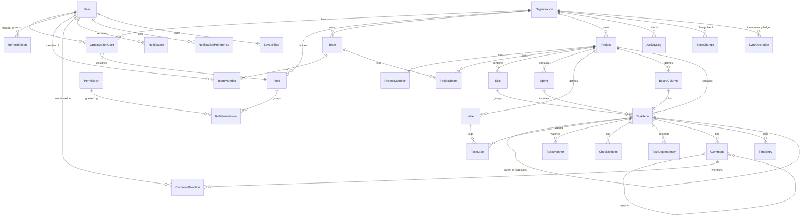

# Entity-Relationship Diagram

The core domain model. Every organization-owned table carries `OrganizationId` (tenant isolation via
an EF Core global query filter). Syncable/auditable tables also carry `RowVersion` (optimistic
concurrency) and, where soft-deletable, `IsDeleted`.

## Notes

- **`TaskItem`** (not `Task`) is the C# entity name — `System.Threading.Tasks.Task` is implicitly in
  scope everywhere via `ImplicitUsings`. JSON/routes/keys still say "task".
- **Attachments** are polymorphic: `(EntityType, EntityId)` binds a file to a Task, Comment, Project
  or Epic without a hard FK, so they aren't drawn as a single relationship above.
- **Cross-aggregate FKs** (assignee, reporter, owner → `User`; org denormalized onto Epic/Sprint/
  Task) use `RESTRICT`/`SET NULL` to avoid SQL Server multiple-cascade-path errors; cascades stay
  within a single aggregate (e.g. Task → Comment, Task → Subtask).
- **`SyncChange.ServerVersion`** is a globally-monotonic `bigint` identity — the client's delta
  cursor. **`SyncOperation.Id`** is the client-generated OperationId (idempotency key).

The authoritative field list is in `planning.md` §3 (Data Model).
